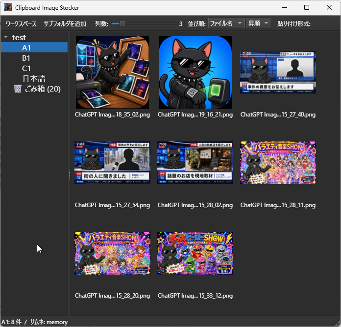

# Clipboard-Image-Stocker

軽量・高速な画像ストックツール (Windows 11 / Python 3.12 + PySide6)



## 主な機能

- ワークスペースモデル: 1 つの基点フォルダを選び、配下のサブフォルダに画像を保存
- フォルダ内画像のサムネイルグリッド表示
- 列数スライダー（1〜16）→ サムネイルサイズ自動調整
- クリップボードからの高速連続貼り付け
- クリップボード監視（自動保存）
- 画像編集機能や検索機能はありません

## 開発セットアップ

```powershell
python -m venv .venv
.\.venv\Scripts\Activate.ps1
pip install -r requirements-dev.txt
python -m stocker
```

## テスト

```powershell
pytest
```

## ポータブル zip ビルド

```powershell
pyinstaller --clean build/stocker.spec
.\build\make_portable.ps1
```

## 既知の制約

### X (Twitter) への D&D は不可、Ctrl+C → Ctrl+V で代用

X (Twitter) の Web UI のドロップハンドラは `e.dataTransfer.files` だけでなく
`UniformResourceLocator` / `CF_HTML` 等の URL 系クリップボード形式も「添付候補」として
カウントするため、Stocker から複数枚を D&D すると 3 枚以上で
「添付できる画像は4枚までです」エラーが出てドロップ自体が失敗します。

これは Qt 6 が `setUrls()` 系 API 経由で複数の Windows クリップボード形式
(`CF_HDROP` + `UniformResourceLocator` + `UniformResourceLocatorW` + `CF_HTML`) を
自動登録する挙動と、Twitter のドロップハンドラの厳しいカウント方式が組み合わさった結果で、
`QMimeData` サブクラスの override では抑制できません (Qt の Windows 層は
内部データを直接見るため)。抜本対策には自前の `IDataObject` + `DoDragDrop`
実装が必要です。

**回避策**: グリッド上で画像を選択して **Ctrl+C** (= 「ファイルをコピー」) → Twitter の
投稿欄で **Ctrl+V**。クリップボード経路では同じ複数形式が登録されますが、Twitter の
ペーストハンドラは `e.clipboardData.files` (CF_HDROP) のみを使うので 4 枚まで正常に
添付できます。Discord / Slack / GitHub / Gmail 等 D&D で問題が出ない先では従来どおり
ドラッグ可能です。
